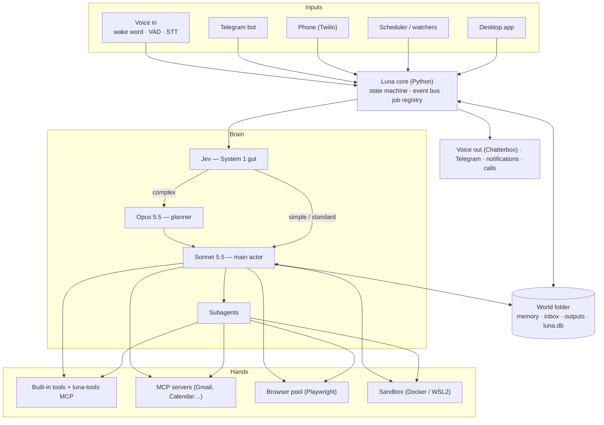
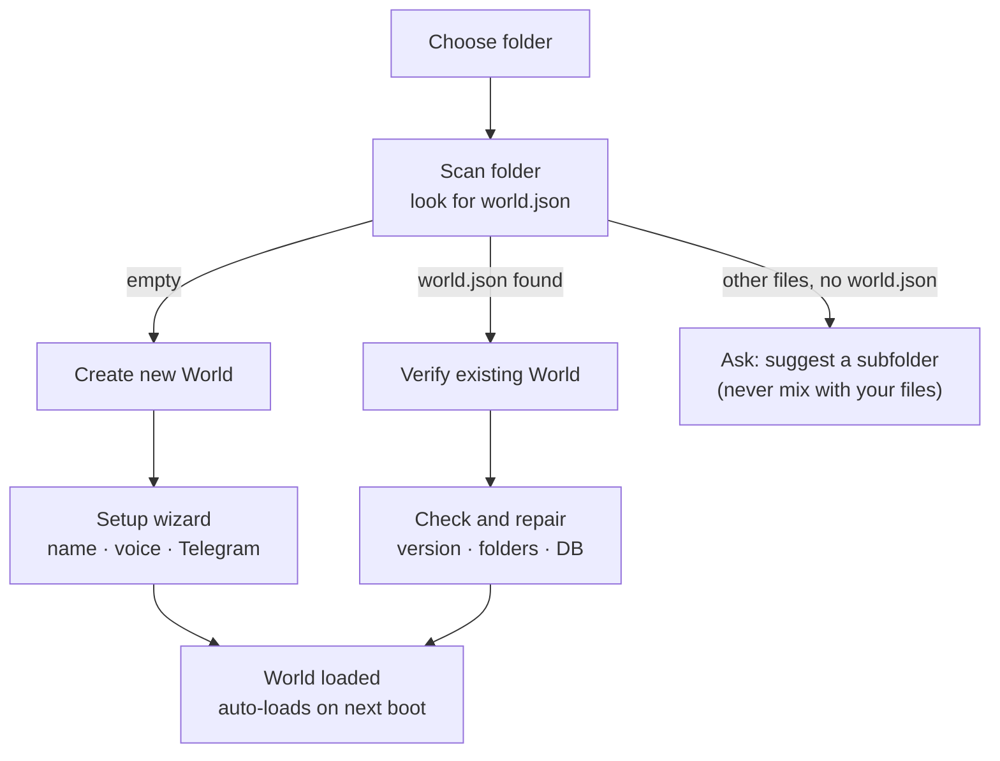
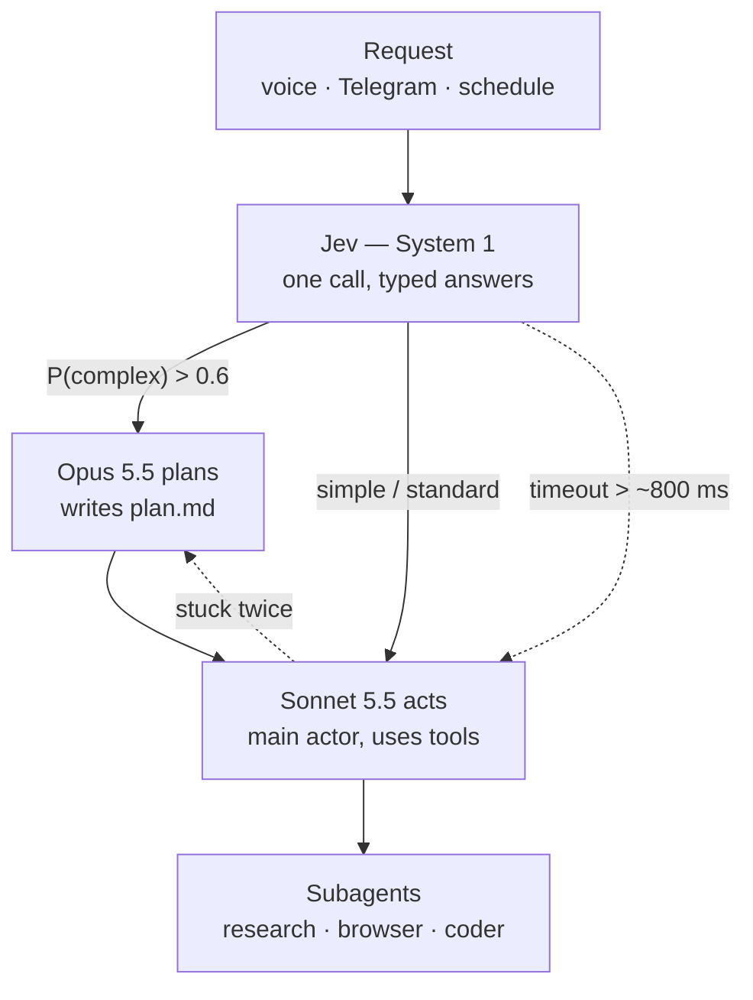
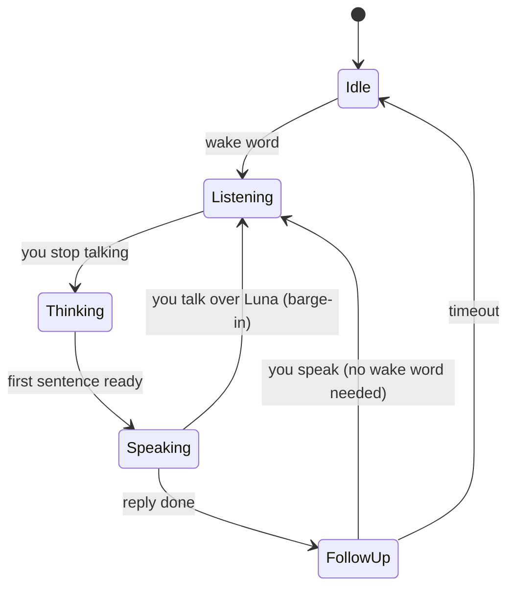
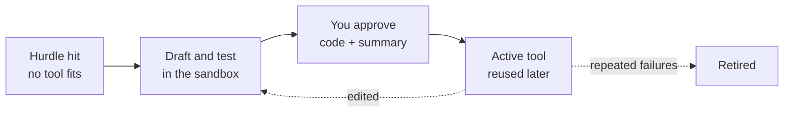

# Project LUNA — Master Plan

_Last updated: 2026-10-05 · Status: planning_

LUNA is a personal, always-on desktop agent for Windows. It uses Claude, run as a background subprocess through the Claude Agent SDK, as its brain. It has a Jarvis-style voice mode with a wake word, full (permission-gated) PC access, a Telegram bot, a scheduler, price watchers, subagents, tools it builds for itself, and one dedicated storage folder called a **World** that holds everything it knows and makes.

Inspiration: Meta's Muse personal agent (launched 2026-09-08). LUNA takes Muse's best ideas (background autonomy, goals, side chats, connectors, a supervisor agent, an audit log) and runs them locally, on your own PC, with voice.

---

## Contents

1. [Principles](#1-principles)
2. [Architecture overview](#2-architecture-overview)
3. [Tech stack](#3-tech-stack)
4. [The World (storage)](#4-the-world-storage)
5. [The brain: Claude subprocess](#5-the-brain-claude-subprocess)
6. [The gut: Jev as System 1](#6-the-gut-jev-as-system-1)
7. [Voice and Jarvis mode](#7-voice-and-jarvis-mode)
8. [Memory](#8-memory)
9. [PC access and safety](#9-pc-access-and-safety)
10. [Self-extension: tools, skills, MCP, subagents](#10-self-extension-tools-skills-mcp-subagents)
11. [Files: finder and inbox](#11-files-finder-and-inbox)
12. [Chats: main, side, temporary](#12-chats-main-side-temporary)
13. [Autonomy: scheduler, Active page, price watchers](#13-autonomy-scheduler-active-page-price-watchers)
14. [Telegram bot](#14-telegram-bot)
15. [Calling: Luna to you, you to Luna](#15-calling-luna-to-you-you-to-luna)
16. [Desktop app, dashboard and audit log](#16-desktop-app-dashboard-and-audit-log)
17. [Reliability and quality of life](#17-reliability-and-quality-of-life)
18. [Code repository layout](#18-code-repository-layout)
19. [Roadmap](#19-roadmap)
20. [Open questions](#20-open-questions)
21. [References](#21-references)

---

## 1. Principles

- **Code and data are separate.** This repo is Luna's code. The World is Luna's data. Luna may extend itself inside the World (tools, skills, MCP servers, subagents), but it **never edits its own core code**.
- **Local first.** Wake word, speech-to-text and text-to-speech run on your PC. Audio never leaves your machine until after the wake word, and even then only as text.
- **Safe by default.** Every action passes through permission tiers. Anything irreversible needs your confirmation. Every action is written to the audit log.
- **Cheap where possible.** Fast decisions go to Jev. Repetitive checks (like price watching) run as plain code with no AI call. Opus is used only for planning.
- **Build the brain first and the looks last.** The orb UI is the flashiest part and the least risky, so it comes after the pipeline underneath it works.

---

## 2. Architecture overview



**One Python process ("Luna core")** owns the mic, the speaker, the Claude sessions, the scheduler and the job registry. The desktop app is only a display: it talks to the core over a local WebSocket, so Luna keeps running when the window is closed. Telegram, phone and scheduled jobs are simply other inputs into the same core.

---

## 3. Tech stack

| Part | Choice | Notes |
|---|---|---|
| Brain | Claude Agent SDK (Python), `ClaudeSDKClient` | Runs Claude Code as a subprocess. Gives streaming, tools, hooks, subagents, permission callbacks and sessions. |
| Models | Sonnet 5.5 (`claude-sonnet-5-5`) acts, Opus 5.5 (`claude-opus-5-5`) plans | Chosen by the gut |
| Gut / System 1 | Jev by TypeSafe AI (`jev-latest`) | Typed decisions with probabilities. Falls back to Sonnet. |
| Wake word | openWakeWord | Local and free. Use `hey_jarvis` while prototyping, then train a custom "Hey Luna" model. |
| End of speech | Silero VAD | |
| Speech-to-text | faster-whisper (GPU) | Local |
| Text-to-speech | Chatterbox (Resemble AI) | Voice cloning from a reference clip, emotion control. Needs a GPU to be fast. |
| Desktop UI | Electron or Tauri + canvas/WebGL orb | Decide based on your JS comfort |
| Core ↔ UI | Local WebSocket (localhost only) | |
| Database | SQLite (`luna.db` inside the World) | Jobs, watchers, tasks, audit log, costs, file provenance |
| Scheduler | APScheduler with a SQLite job store | Jobs survive restarts |
| Browser automation | Playwright (Chromium) | Includes the CDP screencast for live previews |
| Telegram | python-telegram-bot or aiogram | |
| Phone calls | Twilio Programmable Voice | Optional, paid |
| Remote access | Tailscale | Private network to your phone, no public exposure |
| File search | Everything (voidtools) + Windows Search + ripgrep | |
| Tool sandbox | Docker Desktop or WSL2 | |
| Tool dependencies | `uv` + PEP 723 inline script metadata | Each tool gets an isolated, cached environment |
| Secrets | Windows Credential Manager | Never stored in the World |
| Uptime alerts | healthchecks.io (or similar) | Alerts you if Luna goes silent |

---

## 4. The World (storage)

A **World** is a folder with a fixed layout and a `world.json` "ID card" at the top. Everything Luna knows, receives and produces lives here. A World is portable: you can back it up, move it, or open it on another PC. Secrets are kept out of it on purpose.

### 4.1 Schema

```
<Your World>\
├── world.json                  # ID card: id, name, schema version, created date
├── CLAUDE.md                   # Luna's personality and house rules (auto-loaded)
├── .claude\
│   ├── skills\<name>\SKILL.md  # playbooks: "how to do X"
│   ├── agents\<name>.md        # subagents
│   └── settings.json           # permission rules
├── .mcp.json                   # connected MCP servers (no secrets inside)
├── memory\
│   ├── profile.md              # you: preferences, routines, habits
│   ├── people.md
│   ├── goals.md
│   └── notes\
├── inbox\                      # main inputs (read-only for Luna)
├── outputs\
│   └── 2026-10\
│       └── 0142-flight-prices\ # one folder per task
│           ├── task.json       # request, models used, status, file list
│           ├── plan.md         # Opus plan, if there was one
│           ├── snapshots\      # browser screenshots from this task
│           └── report.md       # what Luna produced
├── conversations\              # main chat history, one .jsonl per day
├── sidechats\<name>\           # permanent side chats (own inbox/outputs/history)
├── temp\chat-<id>\             # temporary side chats (deleted with the chat)
├── tools\                      # Luna-built tools (its own git repo)
│   ├── drafts\
│   ├── active\<tool>\          # tool.json, main.py, test_main.py
│   └── retired\
├── mcp\                        # code for local/custom MCP servers
├── voices\                     # Chatterbox reference clips
├── system\
│   ├── luna.db                 # SQLite: jobs, watchers, tasks, audit, costs, files
│   └── backups\
└── logs\
```

### 4.2 Rules

- Inputs always land in `inbox\` (or the chat's own inbox). Luna treats every inbox as read-only.
- Every task gets its own folder under `outputs\` with a `task.json`, so the dashboard can list everything Luna has ever produced.
- Anything with a status (jobs, watchers, audit entries, file provenance) goes in `luna.db`, not in loose files.
- By default, Luna writes only to `outputs\`, `memory\` and its drafts. Writing anywhere else is a permission-tier decision.
- `memory\`, `.claude\`, `tools\` and `CLAUDE.md` are version-controlled with git, so you can see a diff of what changed.

### 4.3 Setup button (choose folder → scan → verify)



**Check and repair** (for an existing World):

1. Read `world.json`.
   - If the World comes from an older Luna version: back it up, then migrate.
   - If it comes from a newer version: ask you to update Luna.
2. Recreate any missing folders, and run an integrity check on `luna.db`.
3. Re-arm scheduled jobs and watchers, and list anything that was missed while the PC was off.
4. Ask again for any secrets this PC doesn't have (for example, when the World was copied from another machine).
5. Show a summary before loading, such as: _"World 'Ahad': 312 conversations, 4 watchers, 6 jobs, last used 2 days ago."_

The same logic is available from the command line as `luna init <path>` and `luna verify <path>`, which is built and tested first. The button just calls it. The path of the last World used is remembered in `%APPDATA%\Luna\settings.json`.

---

## 5. The brain: Claude subprocess

- Run the **Claude Agent SDK** with the **World as its working directory**, and set `setting_sources=["project"]`. Claude then loads `CLAUDE.md`, `.claude\skills`, `.claude\agents` and `.mcp.json` automatically.
- Keep **one warm, long-lived session** (`ClaudeSDKClient`) for the main conversation. Starting a new subprocess for every utterance would add seconds of delay.
- **Rotate sessions:** a 24/7 chat would overflow the context window. Start a fresh session per conversation; continuity comes from the memory files.
- Side chats and temporary chats each get their **own session**.
- Built-in tools and Luna-built tools are exposed through an in-process SDK MCP server called `luna-tools`.
- **Hooks** (`PreToolUse` / `PostToolUse`) feed the audit log. The **`can_use_tool`** callback enforces the permission tiers.
- In voice mode the system prompt asks for 1–3 sentences and no markdown.
- **Decide on auth:** an Anthropic API key (pay per use) or your Claude login. This affects cost and setup (see open questions).

---

## 6. The gut: Jev as System 1

Every request first goes to **Jev**, TypeSafe AI's "System One" model. Jev returns typed answers with calibrated probabilities, not text. TypeSafe reports 70–500 ms latency and $0.042 per million input tokens, with output free. One call answers several questions in parallel.

### 6.1 Routing



- **Simple / standard** → Sonnet (for "simple", with a "keep it short" instruction).
- **Complex** → Opus writes `plan.md` in the task folder → Sonnet carries it out.
- **Uncertain** (for example `P(complex)` = 0.5) → Sonnet, which can escalate to Opus if needed.
- **Stuck twice** → Sonnet hands back to Opus for a new plan.
- **"Think hard"** in your request → skip the gut and go straight to Opus.
- **Jev slow or down** → default to Sonnet. Luna keeps working, just a bit more expensively.
- In voice mode, Sonnet immediately says something like "Give me a sec, planning this out" while Opus works.

### 6.2 The question set (one call)

```python
GUT_QUESTIONS = {
    "complexity": {
        "type": "choice",
        "instructions": "How much thinking does this request need?",
        "criteria": {
            "simple":   "Quick answer or one action",
            "standard": "A few steps or tool calls, no real planning",
            "complex":  "Multi-step, research, building something, or long-running",
        },
    },
    "addressed_to_luna": {
        "type": "noul",
        "instructions": "Is the speaker talking to the assistant, not to someone else or a TV?",
    },
    "risky": {
        "type": "noul",
        "instructions": "Could doing this delete, send, buy, install, or change something important?",
    },
    "urgency": {
        "type": "score",
        "instructions": "How time-sensitive is this?",
        "criteria": ["Whenever", "Today", "Within the hour", "Right now"],
    },
}
# POST https://api.typesafe.ai/v1/systemone
# {"model": "jev-latest", "state": {...request + recent turns + source...}, "questions": GUT_QUESTIONS}
```

| Answer | Used for |
|---|---|
| `complexity` | Which brain handles the request |
| `addressed_to_luna` | Ignoring the TV or other people during the follow-up window (if < 0.3) |
| `risky` | Sending the request to the Sentinel for extra review (if > 0.5) |
| `urgency` | Which rung of the notification ladder to use |

### 6.3 Other System 1 uses

- **Memory filter:** "Is there anything new worth remembering?" The expensive Claude reflection step only runs if the answer is yes.
- **File finder:** "Which of these candidates matches 'the tax PDF from last week'?"
- **Prompt-injection screen:** "Does this content contain instructions aimed at an AI?"
- **Watchers:** "Is the item in stock?" (Jev can't read out the price number itself. Plain code does that.)
- **Subagent choice:** which specialist gets a task.

### 6.4 Jev risks and mitigations

1. It's about three weeks old, and the benchmarks are the vendor's own. Use the Sonnet fallback, and never make Jev a single point of failure.
2. **Shadow mode first:** for 1–2 weeks, run Jev and Haiku side by side, log where they disagree, and set the cutoffs from your own data.
3. **Never the only security gate.** Deterministic permission rules stay in charge. Jev only adds extra review on top.
4. **Privacy:** requests also go to TypeSafe. Check their data retention policy before relying on it.
5. Get the API key from the official console (`console.typesafe.ai`), not from third-party resellers.

---

## 7. Voice and Jarvis mode

### 7.1 Pipeline

Mic (always on, local) → **openWakeWord** → (wake) → **Silero VAD** records until you stop talking → **faster-whisper** → text → core → gut → Claude → text streamed **one sentence at a time** → **Chatterbox** → speakers.

### 7.2 States and the orb



| State | Orb behaviour |
|---|---|
| Idle | Small or hidden, wake word armed |
| Listening | Reacts to mic volume |
| Thinking | Pulses |
| Speaking | Reacts to TTS output volume |

The core sends `{state, level}` to the app about 30 times per second, so the orb only has to animate one loudness value.

### 7.3 Latency budget (rough)

| Step | Time |
|---|---|
| Detecting end of speech | ~0.5–0.8 s |
| Whisper transcription (GPU) | ~0.3 s |
| Jev gut | ~0.07–0.5 s (vendor figure) |
| Claude first sentence | ~1.5–4 s (more with tools) |
| Chatterbox first audio (GPU) | ~0.5–1 s |

Ways to bring it down: keep the session warm, stream sentence by sentence, play a short "mm-hm" sound right away, and keep voice answers short.

### 7.4 Other details

- Barge-in: talking over Luna cuts it off. Echo cancellation (or headphones) keeps Luna from hearing itself.
- Follow-up window: after a reply, you can keep talking for a few seconds without saying the wake word.
- Mic-mute toggle and a push-to-talk hotkey as backup.
- Luna's voice: clone it from a reference clip in `World\voices\`.

---

## 8. Memory

- `memory\profile.md`, `people.md`, `goals.md` and `notes\` are plain Markdown that you can read and edit.
- **Reflection:** after each conversation, if the Jev memory filter says it's worth it, Claude updates the memory files.
- **"Luna, forget that…"** works by voice, Telegram or the memory editor.
- **Weekly diff:** because memory is in git, you can see exactly what Luna learned about you each week.
- Temporary chats read memory but never write to it (see §12).

---

## 9. PC access and safety

### 9.1 Permission tiers (enforced by `can_use_tool`)

| Tier | Examples |
|---|---|
| **Free** | Read files, search, open apps or URLs, media and volume, screenshots, `find_files`, `bring_to_inbox` (copy) |
| **Confirm** (voice "yes", Telegram button or app dialog) | Write, move or delete files outside the World; shell commands that change state; installing software; sending messages or emails; `export_to`; new or edited tools; adding MCP servers |
| **Never** | Password and credential stores, payments, security settings, editing Luna's own core code |

### 9.2 Defences

- **Sentinel:** a second, cheap Claude check that reviews risky actions and new tool code. It's triggered by the Jev `risky` flag, untrusted content, or the confirm tier.
- **Untrusted-content flag:** anything read from the web, emails or files is marked as untrusted. Actions taken right after reading such content get Sentinel review. This is the main defence against prompt injection.
- **Credential isolation:** secrets live in Windows Credential Manager and are supplied to tools and MCP servers at launch. Claude never sees them.
- **Excluded folders:** password vaults, `.ssh`, browser profiles and similar locations are never searched or read.
- **Kill switch:** a global hotkey, `/stopall` in Telegram, or "Luna, stop everything". All three cancel every job, close browser tabs and stop sandboxes.
- **Spending limits** (§17) and the **audit log** (§16).

---

## 10. Self-extension: tools, skills, MCP, subagents

| Kind | What it is | Who makes it | Lives in |
|---|---|---|---|
| Skill | Instructions, loaded only when relevant | You, or Luna after solving something hard | `.claude\skills\` |
| Tool | Python code Luna wrote | Luna, with your approval | `tools\active\` |
| MCP server | A connection to an outside service | You, or Luna proposes it (confirm tier) | `.mcp.json`, `mcp\` |
| Subagent | A specialist worker with its own tools and model | You or Luna | `.claude\agents\` |

### 10.1 Tool lifecycle



- **One-off scripts** stay in the task's outputs folder and are never registered.
- **Manifest** (`tool.json`):

  ```json
  {
    "name": "bestbuy_price",
    "description": "Read price and stock from a Best Buy product page",
    "inputs": { "url": "string" },
    "needs": { "network": ["bestbuy.com"], "host_access": false },
    "version": 3,
    "built_during": "task 0142"
  }
  ```
- **Dependencies:** each script declares its packages inline (PEP 723), and `uv run` installs them into an isolated, cached environment.
- **Sandbox:** new tools run in Docker/WSL2 with only the task folder mounted. Network is off unless the manifest declares it. A tool with `host_access: true` always needs your approval.
- **Approval:** the dashboard or a Telegram button shows a plain-English summary, what the tool can access, the code and the test result. The Sentinel reads the code first.
- **Registration:** `luna-tools` loads `tools\active\` while running, with no restart needed.
- **Versioning:** `tools\` is a git repo, so every change is a commit you can roll back.

### 10.2 Skills from experience

After a hard task succeeds, Luna writes a `SKILL.md` describing what worked. This is procedural memory: the second time is faster and cheaper.

### 10.3 Starting subagents

researcher (web search), browser (forms, reading pages), coder, file-organizer, price-checker.

### 10.4 Capabilities page

Lists every skill, tool, MCP server and subagent, with status, usage, failures, and enable / disable / roll back.

---

## 11. Files: finder and inbox


| Need | Engine |
|---|---|
| File names and paths on any drive, instantly | Everything (voidtools), through `es.exe` |
| Text inside documents | Windows Search index |
| Deep search of one folder | ripgrep |
| "Is this the right one?" | Jev picks from the candidates, or Claude reads the first page of the top few |

**Built-in tools:**

- `find_files(query, type, modified_after, …)`: free tier. Returns paths and metadata only.
- `bring_to_inbox(path, mode="copy")`: copying is free tier. `mode="move"` is confirm tier, and **temporary chats can only copy**. Name clashes get a numbered suffix. Folders are allowed, with a size check.
- `export_to(path, destination)`: confirm tier, because it writes outside the World.

**Provenance:** each inbox file has a record in `luna.db` with the original path, hash, when it was copied, and who asked. The dashboard shows "From `D:\Downloads\tax-2025.pdf`, copied Oct 5".

**Ambiguous matches** show a picker with name, folder, date and a preview (in the app), or buttons (in Telegram).

---

## 12. Chats: main, side, temporary

| Kind | Folder | Session | Memory | Lifetime |
|---|---|---|---|---|
| Main | `conversations\` | Rotated per conversation | Read and write | Forever |
| Side chat | `sidechats\<name>\` | Its own | Read and write | Forever |
| Temporary | `temp\chat-<id>\` | Its own | Read-only (incognito toggle: none) | Deleted when closed, or after 24 h idle |

**Temporary chat layout:** `chat.json` (created, expires, memory mode, linked jobs), `inbox\`, `outputs\`, `conversation.jsonl`.

**Opening one:** "Luna, open a temp chat", `/temp` in Telegram (and `/end` to close it), or a button in the app. The app marks it with a different color, a "Temporary" badge and an expiry timer.

**On close, Luna asks "Keep anything first?"** The options are: save selected outputs to the main `outputs\`, make the chat permanent (moves it to `sidechats\`), or delete everything.

| Item | On delete |
|---|---|
| Temp folder (inbox, outputs, transcript) | Permanently deleted (not sent to the Recycle Bin) |
| Claude's own session transcript (`~\.claude\projects\…`) | Also deleted, or the chat isn't really gone |
| Jobs created in the chat | Luna asks: keep them in the main World, or cancel them |
| Audit log entries | Kept, with content removed (metadata only) |
| Telegram messages | Luna deletes its own where Telegram allows. Yours remain unless you clear them. |

Text already sent to Claude or Jev falls under those providers' data retention policies, which Luna can't change.

---

## 13. Autonomy: scheduler, Active page, price watchers

### 13.1 Scheduler

- APScheduler with its job store in `luna.db`, so jobs survive restarts.
- **Job types:** reminders, recurring prompts ("every weekday at 8, summarize my inbox"), watcher checks, and housekeeping (memory reflection, backups).
- You create jobs in plain language, and Claude calls `schedule_create`.
- Each job has a delivery channel: voice, desktop notification, Telegram, or phone call.
- **Limit:** nothing runs while the PC is off or asleep. When it boots, Luna lists missed runs and either runs them late or skips them, depending on each job's policy.

### 13.2 Active page

Everything that runs or repeats is one row in the `jobs` table: watchers, schedules, reminders, background tasks and subagent runs. Each row shows status, next run and last result, with buttons for pause, resume, run now and cancel. The same list is available in Telegram (`/active`) and by voice ("Luna, what are you working on?").

**Clicking a job expands it in place** to show, from top to bottom:

1. Key facts: target, current value, delivery channel, who created it and when.
2. Controls: pause, run now, cancel, edit.
3. **Browser preview box** (show/hide). It never opens a new window or redirects anywhere.
4. Recent runs, the price history chart, output files, and this job's audit entries.

### 13.3 Live browser preview

- Every Playwright tab is tied to a job (`browser_tab_id` in `luna.db`, plus an in-memory map in the core).
- Show preview → `preview.start(job_id)` → the core attaches through CDP and starts **`Page.startScreencast`**. Chromium then pushes JPEG frames only when the page changes, and the core streams them over the WebSocket into a small box in the app.
- Hide preview, collapsing the card, or leaving the page → `preview.stop`, so it only uses CPU while you're watching.
- **View only by default.** The URL is shown as plain text with a copy button, not as a link. The watched element gets a dashed outline.
- **Later:** a "Take over" button that pauses the job and passes your mouse and keyboard through to the tab (for logins or CAPTCHAs), then Resume.
- **No iframe or webview.** That would be a separate browser without the agent's logins or progress, and many sites block being embedded anyway.

| Job state | Box shows |
|---|---|
| Tab open right now | Live screencast with a red "Live" dot |
| Has used a browser before, but not right now | Snapshot from the last run, with a "Last seen" time |
| Never uses a browser | No preview button |

Every browser run saves a final screenshot to the task's `snapshots\` folder, and it's linked from the audit log. Telegram `/active` has a 📷 button that sends you that snapshot.

### 13.4 Price watchers

- "Watch this RTX 5080, tell me under $900."
- Luna opens the page once with Playwright and works out where the price is shown.
- After that, **every check is plain code** with no AI call, so even 50 watchers cost nearly nothing.
- An AI call only happens if a site redesign breaks the price reader.
- Every check is stored in `luna.db`, so the dashboard can chart price history.
- Alerts trigger on a target price or a percentage drop, through the chosen channel.
- Some stores (Amazon in particular) block scrapers. Use a price-tracking API such as Keepa for those.

### 13.5 Goals and proactivity (from Muse)

- `goals.md` plus a daily "review my goals" job.
- Proactive reminders about deadlines and schedule changes.

---

## 14. Telegram bot

- **Only your chat ID is allowed to use it.** This matters because the bot can control your PC.
- Supports text, **voice notes** (transcribed by Whisper), and **files** (saved to `inbox\`).
- Replies come as text or as a Chatterbox voice note. Output files are sent back.
- **Approval buttons** (Approve / Deny) for confirm-tier actions.
- **Commands:**

  | Command | What it does |
  |---|---|
  | `/active` | List running and scheduled jobs |
  | `/schedule` | See or add schedules |
  | `/watch` | See or add price watchers |
  | `/audit` | Show recent actions |
  | `/temp`, `/end` | Open or close a temporary chat |
  | `/stop`, `/stopall` | Stop the current task, or everything |

---

## 15. Calling: Luna to you, you to Luna

### 15.1 Luna reaching you (escalation ladder)

Telegram bots can't place real voice calls, so Luna uses an escalation ladder:

| Step | How | When |
|---|---|---|
| 1 | Speaks out loud plus a desktop notification | You're at the PC (presence check) |
| 2 | Telegram message plus voice note | Default |
| 3 | Real phone call through Twilio, playing Luna's voice | Urgent, or not acknowledged within N minutes |

The Jev `urgency` score decides where on the ladder Luna starts.

### 15.2 You reaching Luna

- **Telegram voice notes:** not live, but they work from day one.
- **Phone:** call a Twilio number. Luna answers in real time (Twilio Media Streams → Whisper → Claude → TTS). This needs a secure tunnel to your PC, and Luna only accepts calls from your own number.
- **Private voice page over Tailscale:** the same orb UI in your phone's browser, with no public exposure.

---

## 16. Desktop app, dashboard and audit log

**Pages:**

| Page | Shows |
|---|---|
| Home | Orb and chat |
| Active | Running and scheduled jobs, with expandable cards and live preview |
| Schedule | Upcoming jobs |
| Watchers | Price watchers with history charts |
| Agents | Subagent runs |
| Outputs | Everything Luna has produced |
| Inbox | Inputs, with where each file came from |
| Capabilities | Skills, tools, MCP servers and subagents |
| Memory | View, edit and delete what Luna knows |
| Audit | Every action Luna has taken |
| Costs | Spend per model |
| Settings | Includes the excluded-folders list |

The app also has a **setup button** (§4.3), a **temporary chat panel** with the "Keep anything first?" dialog, a **tray icon** and a **global hotkey**.

**Audit log** (filled by SDK hooks, so nothing gets skipped). Each entry records:

- time
- source (voice, Telegram, schedule or app)
- chat (main, side or temp)
- model
- tool, with a summary of its arguments
- permission decision (automatic, approved by you, or denied)
- result
- files touched
- snapshot link
- cost

The **Costs page** shows spend per model per day.

---

## 17. Reliability and quality of life

**Must-haves:**

1. **Spending limits:** a daily and monthly cap per model, with a warning at 80%. When the limit is hit, background jobs pause and Opus becomes ask-first.
2. **Kill switch** (§9.2).
3. **"Is Luna alive?" check:** Luna pings healthchecks.io every few minutes. If the pings stop, that service alerts you, since Luna can't report that it's down.
4. **Backups:** git for the World's text files, and a nightly backup of `luna.db` to another drive or the cloud.
5. **Untrusted-content flag** (§9.2).
6. **Auto-start at login,** with a supervisor that restarts the core if it crashes.

**High value:**

7. **Presence awareness:** Luna checks keyboard/mouse idle time and whether the screen is locked, and picks the notification channel to match. Includes quiet hours and do-not-disturb.
8. **Daily briefing:** today's schedule, overnight job results, watcher changes and deadlines. Delivered by voice the first time you sit down, or on Telegram.
9. **Screen awareness:** "Luna, what's this error?" grabs the active window or clipboard.
10. **Memory editor** (§16).

**Later:**

11. The dashboard on your phone over Tailscale.

---

## 18. Code repository layout

```
Project-Luna/
├── core/                 # Python service
│   ├── brain/            # Agent SDK sessions, Jev gut, routing, Sentinel
│   ├── voice/            # wake word, VAD, STT, TTS, orb levels
│   ├── world/            # schema, init / verify / migrate, backups
│   ├── tools/            # built-in tools + luna-tools MCP server
│   ├── toolsmith/        # draft → sandbox → approve → register
│   ├── jobs/             # scheduler, watchers, Active registry
│   ├── browser/          # Playwright pool, screencast, snapshots
│   ├── files/            # Everything / Windows Search / ripgrep, inbox provenance
│   ├── channels/         # app WebSocket, Telegram, Twilio
│   └── safety/           # permission tiers, audit hooks, spending limits, kill switch
├── app/                  # Electron or Tauri desktop UI
├── docs/
│   └── PLAN.md
└── tests/
```

---

## 19. Roadmap

Telegram and the scheduler come before voice. They deliver the Muse-like value sooner, while voice is the hardest part to get right. Swap the order if Jarvis mode matters more to you.

| Phase | Name | Scope | Done when |
|---|---|---|---|
| 1 | **Foundation** | World schema, `luna init/verify`, Agent SDK brain (Sonnet) with the World as working directory, `CLAUDE.md`, `.claude\`, `.mcp.json`, audit hooks, permission tiers, spending limits, kill switch, backups, `find_files` / `bring_to_inbox` / `export_to`, chat in a terminal | You chat by typing, it remembers your name in the next session, and every tool call shows up in the audit log |
| 2 | **Telegram** | Allowlisted bot, text, voice notes and files, approval buttons, side chats and temporary chats (`/temp`, `/end`), uptime alerts | You can use Luna and approve actions from your phone |
| 3 | **Gut and subagents** | Jev System 1 (shadow mode against Haiku first), Opus plans → Sonnet acts, escalation, first subagents | Routing decisions show up in the audit log with their probabilities |
| 4 | **Scheduler and Active page** | APScheduler, `jobs` table, reminders delivered to Telegram, recurring prompts, `/active` | "Remind me every Monday at 9" works and survives a reboot |
| 5 | **Price watchers** | Browser pool, plain-code price readers, history, alerts, snapshots | A watcher alerts you on Telegram when the price drops |
| 6 | **Self-extension** | Tool lifecycle, sandbox, Sentinel code review, `luna-tools`, learned skills | Luna builds, tests and (after your approval) reuses a tool it wrote |
| 7 | **Voice** | Chatterbox, faster-whisper, openWakeWord, VAD, follow-up window, barge-in, Jev "talking to me?" check | A spoken conversation with replies starting in about 3–5 s |
| 8 | **Desktop app** | Setup button, orb, all dashboard pages, expandable Active cards with live preview, Capabilities, file picker, temp chat panel, memory editor, presence, daily briefing | Daily use goes through the app instead of the terminal |
| 9 | **Calling** | Escalation ladder, Twilio outbound and inbound calls, Tailscale voice page and remote dashboard | Luna calls you for an unacknowledged urgent reminder |

---

## 20. Open questions

1. **GPU:** which one do you have? Chatterbox and Whisper need CUDA to be fast.
2. **Languages:** are you more comfortable in Python, JS, or both? This decides Electron vs Tauri vs an all-Python UI.
3. **Wake word:** "Hey Luna", or something else?
4. **Claude access:** API key (pay per use) or your Claude login?
5. **Twilio:** is real phone calling worth the small monthly cost, or is Telegram enough for now?
6. **Price watching:** which stores?
7. **Uptime:** will the PC stay on 24/7?
8. **Sandbox:** do you have Docker Desktop or WSL2 installed?
9. **Temporary chats:** keep the content-free audit record (recommended), or wipe everything?
10. **Jev privacy:** are you OK with requests also going to TypeSafe?

---

## 21. References

- Claude Agent SDK — docs.claude.com (Agent SDK overview, Python SDK)
- Jev / TypeSafe AI — [Apidog: What is Jev?](https://apidog.com/blog/what-is-jev/), [LLM Reference](https://www.llmreference.com/provider/typesafe-ai/jev), [OpenRouter: Jev Router](https://openrouter.ai/typesafe/jev-router)
- Meta Muse — [Vellum breakdown](https://www.vellum.ai/blog/official-muse-breakdown), [36Kr](https://eu.36kr.com/en/p/3975505284116737), [Build Fast with AI review](https://blog.buildfastwithai.com/muse-personal-ai-agent-review)
- openWakeWord · Silero VAD · faster-whisper · Chatterbox (Resemble AI) · Playwright · APScheduler · python-telegram-bot · Twilio · Tailscale · Everything (voidtools) · uv
